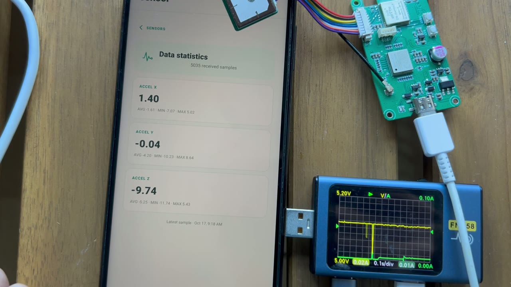

# Wi-Fi HaLow PAwR-like low-power sensor demo

[](videos/halow-sensor-pawr-low-power-voiceover.mp4)

Select the image to play or download the 48-second narrated demonstration.

This prototype uses an nRF54L15 host with the EdgeZ FGH200M/MM8108 radio as a
connectionless, duty-cycled sensor. The term **PAwR-like** describes the
request/response behavior: it is inspired by periodic advertising with
responses, but it is implemented over Wi-Fi HaLow vendor action frames rather
than the Bluetooth PAwR protocol.

The `edgez-nrf54l15-fgh200m-sensor` environment compiles Bluetooth out of the
image and is separate from the `edgez-nrf54l15-fgh200m-companion` BLE/full-mesh
role. With a stored sensor profile, the sensor firmware:

1. Stops BLE and does not run mesh peering, mesh beacons, BATMAN routing, or
   GPS.
2. Uses the LSM6DSL accelerometer hardware FIFO while the nRF54L15 remains in
   tickless System ON idle between reports.
3. Wakes on a 15-second interval, drains the IMU FIFO, and wakes the initialized
   MM8108 from chip sleep.
4. Broadcasts one sensor beacon and waits up to 500 ms for a receiver-generated
   application acknowledgement. It does not retry in the same cycle.
5. Returns the MM8108 to chip sleep and lets the nRF54L15 return to tickless
   idle. The HaLow rail remains powered so later reports avoid firmware reload
   and full radio initialization.

The video shows the mobile sensor view and the supply-current waveform during a
reporting cycle. Treat it as a qualitative demonstration, not a calibrated
battery-life result. Disconnect the J-Link probe and other debug interfaces for
power measurements, and record the supply voltage, reporting interval, RF
conditions, payload size, and acknowledgement behavior with any published
current figure.

Higher HaLow throughput can reduce radio-on time for a given payload, making
this approach attractive when a long-range sensor occasionally needs to send
more data than a conventional low-rate LPWAN node. Actual energy per kilobyte
still depends on wake overhead, RF conditions, data rate, payload size, and the
receiver topology.

## Reliable sensor settings downlink

Provisioned HT-HC33 and nRF54L15 sensor images accept the existing reliable
downlink command `sensor.settings`. The command body is a complete, atomic
settings document:

```json
{
  "samplingIntervalMs": 15000,
  "sendBlocks": true,
  "samplesPerBlock": 8
}
```

`samplingIntervalMs` is valid from 1,000 through 3,600,000 ms and controls the
sensor wake/sample interval. `samplesPerBlock` is valid from 1 through 32. A
normal beacon is still sent every interval when `sendBlocks` is false; sample
block accumulation and transmission are disabled. Send this document through
`POST /devices/{deviceId}/commands` as the `payload` with `command` set to
`sensor.settings`.

The sensor writes the new settings to persistent storage before acknowledging
the downlink message ID. Invalid documents are not acknowledged and therefore
follow the normal server retry/failure policy. Changing settings discards an
incomplete block so one block never mixes samples collected under different
settings.

Every block begins with a 24-byte `EZSB` version 1 header. The header records
the sample kind, block sequence, record size and count, plus the exact
`samplingIntervalMs`, `sendBlocks`, and `samplesPerBlock` snapshot that produced
the block. HT-HC33 records contain MCU temperature floats. nRF54L15 records
retain three acceleration axes, three gyroscope axes, and a gyroscope-valid
flag. A block remains buffered until H7608 returns the PAwR bulk ACK.

HT-HC33 stores its active settings and pending samples in RTC memory during
timer deep sleep; it reads NVS only on a cold/non-timer start or an invalid RTC
cache. nRF54L15 uses System-ON sleep, so settings are loaded once during
application startup and the pending sample block remains in retained RAM. On
both targets the existing button behavior remains authoritative: a button wake
starts a fresh five-second hold timer, and completing the hold erases the
persistent settings along with the provisioning state.
