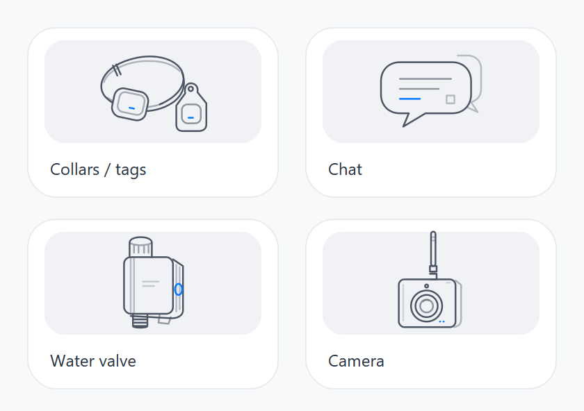

# Device Hub UI prototype / 设备中心 UI 交接

An interactive, offline HTML reference for rebuilding the mobile App UI. Start
with this folder; the existing telemetry website is a separate product surface.
The prototype uses simulated data and does not connect to BLE, MQTT, Appwrite,
or hardware. See [UI_HANDOFF.md](UI_HANDOFF.md) for field mappings, state behavior,
and the remaining App/firmware integration work.

## Open and review / 打开与查看

Download this branch and open `docs/ui-prototype/index.html` in a browser.
Windows users can also double-click `open_prototype.bat`. Keep the whole folder
together. No npm install, build step, server, or cloud login is required.
GitHub's HTML file viewer displays source code rather than running the page.

本目录是给 App 同事参考的网页展示板。打开 `index.html` 后，使用页面上方的
场景控制切换“未连接 / 已连接空网络 / 活跃网络”，检查浅色、深色及不同语言。
地图是可操作的示意图，硬件参数、搜索结果、登录和消息回执均为模拟。
浏览器麦克风录音取决于浏览器权限和能力；也可以选择本地音频文件。

## What to review / 本轮范围

- **Device Hub:** four compact product cards, native line artwork, nearby-device
  discovery and pairing states. Water valve and camera are entrance cards only.
- **Collars / tags:** gateway, node list and details, aliases, last report,
  battery voltage, signal, location, illustrative map and editable geofences.
- **Chat:** independent communication product, public channels and direct
  messages, text/image/voice composition, separate simulated delivery and read
  receipts, failure and retry states.
- **Profile:** local identity, demo OTP/password login, target-specific HaLow
  settings, storage/preferences, light/dark themes and 12 offline languages.

设计沿用黑白灰、系统蓝、圆角和紧凑双列入口；不采用绿色主色或实物渲染。
“项圈 / 耳标”同时适用于牛羊；聊天设备与项圈网关分别管理连接和配置。



This image previews only the four SVG illustrations; it is not a screenshot of
the complete interface. The interactive HTML is the layout reference.

## Source guide

| File | Purpose |
| --- | --- |
| `index.html`, `product-ui.css` | Presentation frame and visual styles |
| `product-ui.js` | Routes, demo state, validation and local interactions |
| `product-art.js`, `assets/line-art/` | Product SVG artwork and standalone exports |
| `media.js` | Local image/audio selection and optional microphone capture |
| `i18n.js`, `locales/` | Offline translations and their editable sources |
| `radio-catalog.js`, `sync-radio-catalog.py` | Generated firmware-template channel catalog |
| `verify-board.cjs` | Browserless model and template checks |
| `UI_HANDOFF.md` | Chinese integration specification and explicit interface gaps |

## Validation

From this folder, using Node.js and Python 3:

```sh
node verify-board.cjs
python locales/compile-locales.py --check
python sync-radio-catalog.py --check
```

The catalog check additionally needs the two pinned firmware submodules. From
the repository root, initialize only those source dependencies:

```sh
git submodule update --init --depth 1 firmware/platforms/esp-halow
git -C firmware/platforms/esp-halow submodule update --init --depth 1 halow/components/mm-iot-sdk
```

Alternatively, pass `--source /path/to/mmregdb.c`. The bundled catalog lets the
UI open without initializing submodules. It preserves all registered regions
and per-channel fields in that source template; it does not certify a hardware
SKU or current regional compliance.

The checks exercise the model and generated templates, not browser rendering,
native permissions, live transport, or hardware. Browser/phone visual review
and end-to-end integration remain necessary. Do not use real credentials in
the demonstration. Demo OTP: `123456`; demo password: `Demo@123456`.

## App implementation handoff / 对接重点

请先阅读 [UI_HANDOFF.md](UI_HANDOFF.md)，再将交互迁移到 React Native。重点对齐
设备身份与网关归属、遥测来源和时间、配置下发与读回、围栏执行端及同步、媒体
编码与传输、真实 ACK 和独立已读回执。密码登录目前仅为展示；上游配置尚未启用
密码认证。网页行为不能作为这些生产接口已经实现的证明。

This delivery adds only `docs/ui-prototype/`. It does not change production
mobile, website, firmware, backend, authentication settings, or deployment.
